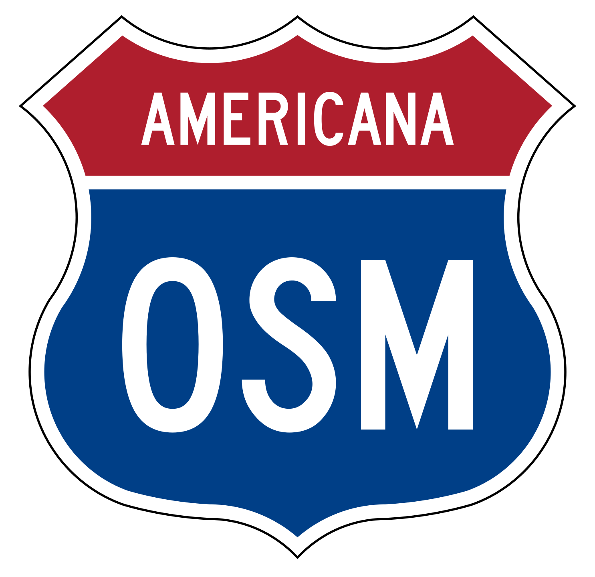
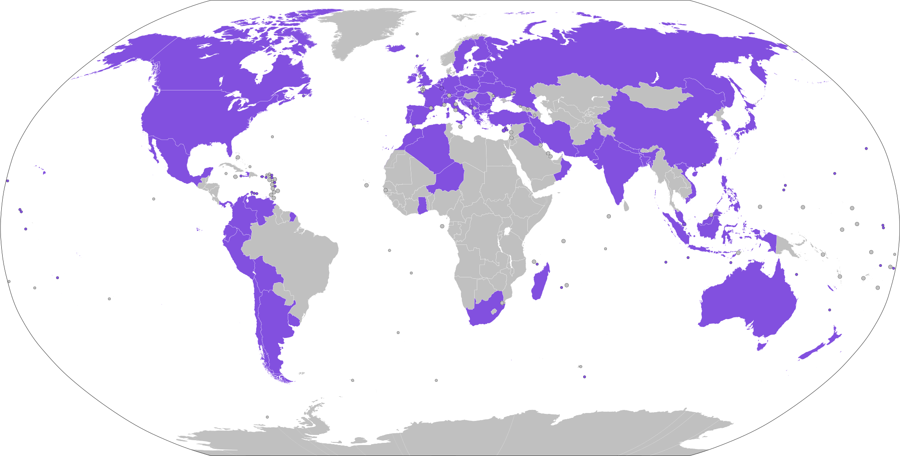

# AARoads Maps featuring OpenStreetMap Americana

[🗺 View the map](https://aaroads-wiki.github.io/openstreetmap-americana/)

## Introduction

The [AARoads Wiki](https://wiki.aaroads.com/) has partnered with [OpenStreetMap](https://www.openstreetmap.org/) and [OSM Americana](https://github.com/osm-americana/openstreetmap-americana/) to bring you AARoads Maps, a digital recreation of the heyday of print transportation atlases in North America, brought back to life with interactivity and personalization. AARoads Maps enhances [countless infoboxes and other contexts](https://wiki.aaroads.com/wiki/AARoads:Maps), making it easy for visitors to find their bearings as they read the mellifluous article text. The OSM Americana style was chosen for its reliance on freely licensed, community-maintained OSM data, its use of modern map technology, and its adherence to a visual style that North American roadgeeks would feel right at home in.

This fork retains OSM Americana’s characteristic shields but tweaks the colors to match [a color scheme for static maps](https://en.wikipedia.org/wiki/Wikipedia:WikiProject_U.S._Roads/Maps_task_force#Standards) that the AARoads Wiki’s predecessor, the English Wikipedia’s WikiProject U.S. Roads, [adopted in 2006](https://en.wikipedia.org/wiki/Wikipedia_talk:WikiProject_U.S._Roads/Maps_task_force/Archive_1#Voting) with minor subsequent adjustments.

## Explore AARoads Maps

The interactive map is available [at aaroads.com](https://www.aaroads.com/aamaps/) or with additional features [on GitHub Pages](https://aaroads-wiki.github.io/openstreetmap-americana/). Click the Legend button to learn the meaning of each symbol, line, and color based on the features currently visible on the map. Click the 🌐 button to simulate a physical globe. Click the ⛰️ button to simulate a relief map.

The style tries to label places in [your browser’s preferred language](https://www.w3.org/International/questions/qa-lang-priorities). To change this preference, consult your browser’s documentation: [Chrome](https://support.google.com/chrome/answer/173424), [Firefox](https://support.mozilla.org/en-US/kb/use-firefox-another-language), [Safari for macOS](https://support.apple.com/guide/mac-help/change-the-system-language-mh26684/mac), [Safari for iOS](https://support.apple.com/en-us/HT204031). To override this preference, click the Change button in the lower-right corner of the map. Alternatively, add `&language=` to the URL, followed by a comma-separated list of [IETF language tags](https://www.w3.org/International/articles/language-tags/). For example, here’s a map labeled [in Portuguese, falling back to Spanish](https://aaroads-wiki.github.io/openstreetmap-americana/#language=pt,es). If we don’t have the name of a place in any of your preferred languages, the style shows the name in the local language as a last resort.

## Bring a slice home with you

You can [build and deploy OSM Americana](INSTALL.md#production-builds) anywhere as static Web page or integrate it into your own Web application via an NPM package. If your project has specific needs that do not apply more generally to this project’s audience, feel free to fork this repository.

OSM Americana is a Web application that generates a [MapLibre stylesheet](https://maplibre.org/maplibre-style-spec/) at runtime. Many Web and mobile software applications can display MapLibre stylesheets. You can point these applications to [this prebuilt stylesheet](https://aaroads-wiki.github.io/openstreetmap-americana/style.json) in JSON format, with the following caveats:

- Route shields and some point of interest icons are missing.
- Labels are in the local language and units, not your preferred language and units.

The same caveats apply if you set up a simple MapLibre map using this JSON file. For the full OSM Americana experience, install the following MapLibre plugins:

- [Americana Shield Renderer](https://github.com/osm-americana/maplibre-gl-shields/) ([`@americana/maplibre-shield-generator`](https://www.npmjs.com/package/@americana/maplibre-shield-generator)) for route shields. [Shield definitions](https://americanamap.org/shields.json) are available for typical maps.
- [Diplomat](https://github.com/osm-americana/diplomat/) ([@americana/diplomat](https://www.npmjs.com/package/@americana/diplomat)) for localized labels.

These plugins are compatible with any MapLibre style. Install them on your Web page to lend your map an Americana level of sophistication.

The map’s contents come from tiles that conform to the [OpenMapTiles schema](https://openmaptiles.org/schema/). The default configuration uses tiles hosted by the [OpenStreetMap U.S. Tileservice](https://tiles.openstreetmap.us/vector/openmaptiles/). The [tile server usage policy](https://tiles.openstreetmap.us/usage-policy/) describes the allowable usage of this tileset. Compatible tilesets are also available from several commercial hosts. Alternatively, you can [set up your own tile server](INSTALL.md#running-your-own-tile-server) on cloud infrastructure at relatively modest cost.

## It takes a village

Come join our barn raising! [OSM Americana](https://github.com/osm-americana/openstreetmap-americana/) is a hands-on opportunity to learn more about maps than you can simply as an armchair mapper or Web developer. Bring your map collection and help us identify elements of print cartography that can be driven by OSM data. Help us investigate any changes that our dependencies need to make to implement these features. Let us know about any highway route system that lacks representation on the map. Try your hand at implementing a route shield.

To learn more about contributing, see our [contributing guide](CONTRIBUTING.md). You can also help out indirectly by contributing to [our data sources](ACKNOWLEDGEMENTS.md#data-sources).

## Coverage

Americana is compatible with vector tiles covering the entire world.

Americana displays custom route shields for routes in all U.S. states and territories, and for routes in the following countries:

We are hoping that it will support more countries; you can [help us](https://github.com/osm-americana/openstreetmap-americana/projects/1)!

## Acknowledgments

[OpenStreetMap U.S.](https://openstreetmap.us/), OpenStreetMap’s local chapter in the United States, supports OSM Americana as a community project by providing tile rendering and other computing infrastructure. You can support their work by [donating to OpenStreetMap U.S.](https://openstreetmap.us/get-involved/donate/)

The source code and artwork in this repository are [dedicated to the public domain](LICENSE) under a CC0 waiver. Some icons incidentally depict logos or insignia that may be subject to trademark restrictions when used outside the context of a map. See the [full acknowledgments](ACKNOWLEDGMENTS.md).
